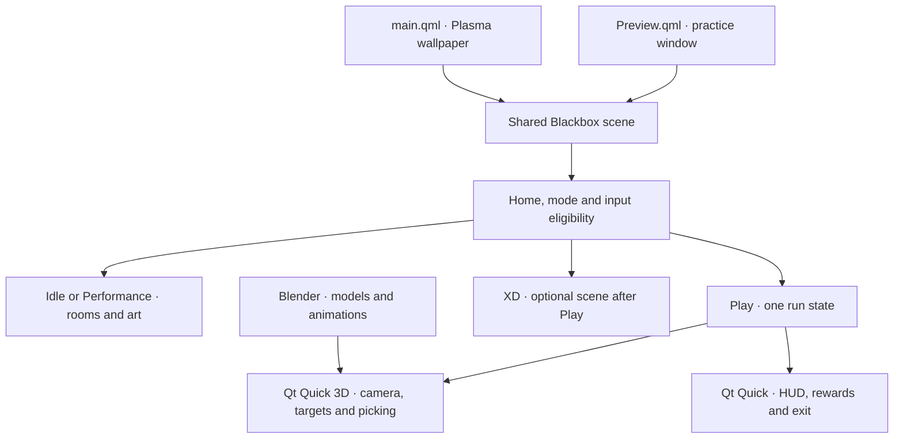

> Current code and desktop activation: [Desktop guide](../Desktop/README.md). For a beginner's trace through the implemented code, use [Learn the current build](LEARN-CURRENT-BUILD.md). This longer design document retains future experiments; the current scope and verification are recorded in [Status](STATUS.md).

# Project Blackbox implementation and learning plan

The first release is an endless demon defence game you can start from the Home Shrine wallpaper on Star Rain. Aim with the mouse, turn between five fixed views, clear a wave, take a reward in Droid Lab, and play the next wave. Escape pauses the game; Quit returns to the previous wallpaper mode. Begin with a counter that proves the real desktop can receive and release input, then build combat with cubes. The same project can grow into animated Idle scenery and, eventually, XD's fully 3D backgrounds.

- [First session](#0--run-and-understand-the-template)
- [Home and the four modes](#home-and-the-four-modes)
- [Plasma input trial](#1--prove-input-and-lifecycle-on-plasma)
- [Play milestones](#2--render-and-hit-one-3d-target)
- [Blender lessons](#learn-blender-with-blackbox-assets)
- [Shader experiment](#try-the-existing-shader-wallpaper)
- [Release checks](#release-checks-on-star-rain)

## What we have today

| Open this file | What it does |
| --- | --- |
| [V0.1/Preview.qml](../V0.1/Preview.qml) | Starts a normal Qt window, loads the shared scene, and saves preview settings in `project-blackbox-preview.ini`. This is where we can learn and iterate quickly. |
| [Rooms.js](../V0.1/kde/contents/ui/Rooms.js) | Defines room IDs, titles, routes, transition names, constellation positions and actions. Change the data here when a room label or route needs to change. |
| [Scene.qml](../V0.1/kde/contents/ui/Scene.qml) | Draws the art and controls. `move()` looks up a route, `go()` starts the travel, and `commit()` makes the destination current. The file also contains the editor, image fallback, ambient timer and keyboard handlers. |
| [BlackboxButton.qml](../V0.1/kde/contents/ui/BlackboxButton.qml) | Defines the shared button appearance and focus indicator. |
| [main.qml](../V0.1/kde/contents/ui/main.qml) | The Plasma entry point. It creates the same scene inside a `WallpaperItem` and reads and writes Plasma's wallpaper settings. |
| [metadata.json](../V0.1/kde/metadata.json) and [main.xml](../V0.1/kde/contents/config/main.xml) | Tell Plasma the package ID, package type and settings defaults. The package ID is `local.starrain.projectblackbox`. |
| [Artwork directory](../V0.1/kde/contents/images/) | Eight flat images for seven rooms. The Shrine image is 1672×941. The other images, including both Abyss variants, are 1600×900. |
| [blackbox-star-drift.frag](../V0.1/shaders/blackbox-star-drift.frag) | The optional Shadertoy-style starfield. The current Blackbox scene draws its own ambience in QML. |
| [tools](../V0.1/tools/) | A read-only KDE inspection script, an optional Python preview launcher, and a generator for the placeholder artwork. |

The ordinary wallpaper has four routes from the Shrine. Left opens Media, right opens the Droid Lab, up opens Star Sky, and down opens the Abyss. The opposite direction returns to the Shrine. The tabs jump directly to rooms. A Star Sky button selects a star, and the selected star's action opens its destination. The image editor stores a reference to the chosen file. Moving that file causes the scene to show its sample again.

Today a turn fades, scales or tilts two flat pictures. The Abyss drop, vault door and burst of stars are QML layers. Performance already switches rooms immediately and stops the ambient timer. The playfield, demons, shots, waves, 3D models and real window coverage handling are future work. The current audio pulse and load readouts use demo values. The package sets `exposed` from `wallpaper.visible`, which gives us item visibility. Coverage, lock and input ownership need their own signals. [Plasma WallpaperItem](https://api.kde.org/qml-org-kde-plasma-plasmoid-wallpaperitem.html)

The [game brief](PLAN.md) describes the intended loop and tone. The [older wallpaper plan](../V0.1/PLAN.md) supplies visual and desktop integration ideas, including native virtual desktop routing. The first Play release uses the current room system and a single Home host. Native desktop routing can be evaluated after that release.

### What was checked on this workspace

| Check | Result |
| --- | --- |
| Installed software | Arch, KDE Wayland session, Plasma Workspace and KWin 6.8.2, Qt 6.12.0 with Qt Quick 3D and Shader Tools, Blender 5.2.3, and Shader Wallpaper 4.2.4. Its ID is `online.knowmad.shaderwallpaper`. Plasma's saved wallpaper references the stock Image provider. |
| Preview | An isolated run loaded the Shrine, followed both loops with keys, returned Home, stopped the ambient timer in Performance and simulated cover, recovered from a missing custom image, and closed the editor with Escape. Rename and Performance settings loaded in a fresh preview process. |
| Package | `kpackagetool6` installed and listed the package under a temporary package root. The live wallpaper selection was left in place. |
| 3D and art tools | Qt Quick 3D QML types instantiated. The isolated process could not validate a rendered viewport or a hit, so Stage 2 repeats that check in the desktop session. Blender wrote a sample `.glb`. The installed Balsam import plugin failed to load because `libassimp.so.6` was missing. The [Blender lesson](#learn-blender-with-blackbox-assets) includes the fix for the import lesson. |

## Home and the four modes

For this plan, Home is one chosen Plasma workspace on your main display. Home Shrine is its landing view and the place where Play starts. The original room tours happen inside that wallpaper while you are on Home. Play's five camera views and the Droid Lab reward screen also live on Home. A room, a camera view and a Plasma virtual desktop have separate state. If you intend Home to mean the Shrine artwork specifically, narrow the mode gate to that view and decide how the existing room tour should behave when it arrives elsewhere.

| Mode | What you use it for | Rendering and controls |
| --- | --- | --- |
| **Idle** | The everyday interactive wallpaper. Browse the seven rooms, click objects such as stars, edit art and see short camera transitions. | Start with V0.1's pictures and effects. Add short 3D camera moves once the game is playable and keep most settled backgrounds still. |
| **Play** | Opt into endless wave defence from the Shrine. Turn to threats, shoot, use the Void counter, and draft rewards. | The wallpaper hosts one active run and one 3D view. Gameplay input, simulation and sound run while you are eligible to play. |
| **Performance** | Use the same room art, links and basic controls with low GPU cost. | Use one still image and immediate room changes. Unload the 3D viewport and animated effects and stop decorative timers and audio processing. |
| **XD** | Opt into full 3D scenery, depth, lighting and richer movement on Home. | Build this from measured experiments after Play and Idle pass their checks. The first XD scene can be a single courtyard. |

Leaving Home, locking, covering the playfield, or losing the play surface's input focus pauses Play and clears held keys and mouse buttons. On return, show Resume and Exit once the surface is eligible again. Escape while Play owns the keyboard and the visible Exit button lead to the same cleanup. Restore the passive mode you came from. Keep a paused run in memory while its host survives. If Plasma unloads that host or the session ends, start in the saved passive mode on the next launch. Outside Home use static artwork and ordinary Plasma input. Pick what screen and workspace count as Home before implementing the gate.

Plasma loads a wallpaper provider for a desktop containment, which is the desktop's QML container for an output and Activity. Verify the virtual desktop signal on Star Rain and use it to gate Blackbox when a containment spans workspaces. Use the same gate for demos, sounds and effects. Keep an active Play run on a single output so connecting a monitor or opening desktop settings cannot start a second instance. [Plasma shell wallpaper and containment source](https://github.com/KDE/plasma-workspace/blob/master/shell/shellcorona.cpp), [KWin workspace API](https://develop.kde.org/docs/plasma/kwin/api/)

## The languages and tools you need

| Name | What it is | First thing to learn |
| --- | --- | --- |
| **Arch Linux** | The OS on Star Rain. `pacman` installs and queries system packages. | Open Konsole, use `pwd` and `cd`, and read `pacman -Q`. [Arch pacman manual](https://man.archlinux.org/man/pacman.8.en) |
| **Plasma, KWin and Wayland** | Plasma draws the desktop and panels. KWin is the compositor that manages windows and routes input in the Wayland session. A wallpaper runs inside Plasma's desktop surface. | Find Configure Desktop and Wallpaper, show the desktop, and switch virtual desktops. Learn that QML item focus belongs to a window that first needs keyboard input from KWin. [Qt Quick keyboard focus](https://doc.qt.io/qt-6/qtquick-input-focus.html), [KWin workspace API](https://develop.kde.org/docs/plasma/kwin/api/) |
| **QML and Qt Quick** | QML describes UI objects and how their properties relate. Qt Quick draws them and delivers clicks and keys. | Read `id`, `property`, bindings such as `visible: root.room === "sky"`, and signals such as `onClicked`. Follow a Shrine arrow to `move()` and `go()`. |
| **JavaScript** | The language inside QML handlers and in `.js` files. It will handle small rules such as spending ammo and counting living enemies. | Read the room table, then write a function that receives `ammo` and returns the next value for one shot. Learn arrays, objects, functions and conditions through that example. |
| **Qt Quick 3D** | The QML module for cameras, lights and 3D models. A `View3D` draws into an area of the wallpaper. | Make a cube, add a camera and a light, and change the cube's depth. [Qt Quick 3D overview](https://doc.qt.io/qt-6/qtquick3d-index.html) |
| **Blender** | The editor where you create models, materials and animations. `.blend` is your editable source and `.glb` is an export for another engine. | Make and export one recognizable prop before rigging a demon. [Blender glTF exporter manual source](https://github.com/KhronosGroup/glTF-Blender-IO/blob/main/docs/blender_docs/scene_gltf2.rst) |
| **GLSL** | A shader language that runs on the GPU. The star drift shader calculates a colour for each fragment using its coordinate and the current time. | Change one tint or drift speed. Learn Qt's shader packaging after the starfield works in the existing plugin. [Qt ShaderEffect](https://doc.qt.io/qt-6/qml-qtquick-shadereffect.html) |
| **JSON, XML, Bash and Python** | JSON and XML hold package and settings data. Bash runs terminal commands and the inspection script. The supplied Python scripts offer an alternate preview launcher and generate placeholder images. | Read the current mode in the config and run the Bash inspection script. QML and JavaScript are sufficient to start implementing Play. |

Work in small cycles. Open a file in Kate, read one function, say what you expect to happen, change one thing, then relaunch the preview and try it. Keep a short note of the result. If you're pairing with Codex, take the change yourself for the first room rename, first input log and first model import. Ask it to point at the relevant lines and help you read any errors.

### Your first QML change

Save this as `ClickPractice.qml` in a practice folder of your choice. In Dolphin, open the folder and use **F4** to show a terminal there, or use `cd` from Konsole. Run `qml6 ClickPractice.qml`.

```qml
import QtQuick
import QtQuick.Controls

ApplicationWindow {
    id: practice
    width: 360
    height: 220
    visible: true
    property int hits: 0

    Button {
        anchors.centerIn: parent
        text: "Hits " + practice.hits
        onClicked: practice.hits += 1
    }
}
```

`id` gives the window a name within this file. `property int` declares a whole number. `text` is bound to that number, so changing it in the click handler updates the label. Change the increment from 1 to 2 and relaunch. This is the same relationship you will use between ammo state, a shot command and its HUD readout.

## How the code fits together



Retain the two existing entry points and reuse `Rooms.js` for ordinary browsing. Add the first game probe as a small QML component so it can be loaded in both hosts. When the probe becomes a game, give the run one owner. A proposed `PlayScene.qml` handles input and presentation, a `PlaySession.qml` holds the live state and controls when the game clock advances, and a small JavaScript file holds rules once there is enough shared logic to extract. Introduce these as their jobs appear. Keep the seven-room editor independent of the combat input area.

- **Host inputs.** The preview can supply normal window focus and simulated coverage. Plasma supplies the actual workspace, lock, output and focus signals. Pass the minimum state into the scene and compute whether it may activate. Recompute from all of the current conditions so that unlocking while still covered keeps the run paused.
- **Desktop state.** Keep room edits, duration, ambient FPS and motion preferences. Map the existing stored `wallpaper` value to Idle and keep `performance`. Persist the chosen passive preference separately from a run. Launch and resume a run only through a user action.
- **Run state.** Keep current phase, wave, random seed, fronts, enemies, projectiles, ammo, shield, health, active ability and rewards in a single session. Track which front the player is viewing separately. UI buttons send commands to the session and the HUD reads the resulting state.
- **Rendering.** The game has one shared world and one active camera. Render a QML HUD over it. Load the Play component and its `View3D` only when required. If an optional module or asset fails, report the failure and keep the wallpaper navigable. Put runtime assets under `kde/contents/` and keep Blender source files outside the installed package.
- **Timing.** Use one clock for enemy motion, cooldowns, attacks and waves. Start with elapsed frame time feeding a fixed update step such as 1/60 second. Cap catch-up steps after a stall, and reset the elapsed-time accumulator after pause so it cannot advance enemies by the time spent on another task. HUD and audio respond to game events. Wallpaper animation FPS, game updates and display refresh have separate jobs. [Qt FrameAnimation](https://doc.qt.io/qt-6/qml-qtquick-frameanimation.html)

The dependency order is **template → desktop input → one working 3D shot → fight on multiple fronts → wave and reward loop → art and release**. A Blender practice prop or shader trial can fit in while learning, since neither is required for the first shot.

## 0 · Run and understand the template

1. Open Konsole on Star Rain. `cd` enters a folder and `pwd` prints where you are. Enter these lines one at a time.

   ```bash
   cd "$HOME/Projects/PROJECT-BLACKBOX/V0.1"
   pwd
   bash tools/inspect-kde.sh
   pacman -Q plasma-workspace kwin qt6-declarative qt6-quick3d qt6-shadertools blender
   qml6 Preview.qml
   ```

2. Leave the terminal open to see errors. In the preview, use Right four times, then Down four times. Try Up to reach Star Sky, select a star, and reshuffle the constellation. Try **Edit**, rename one room and restore the name. With **Performance** on, confirm navigation is immediate. Close the preview through its window controls when finished.
3. In Kate, find `shrine` in `Rooms.js` and `function move(direction)` in `Scene.qml`. Trace Right from the handler to the displayed room. Try a tiny data edit such as changing the Shrine subtitle, then reopen the preview. Save a baseline copy or a Git checkpoint before bigger edits.
4. Record the versions, display scale, monitor and current wallpaper settings. Take a baseline measurement with the Image wallpaper before the live trial if you can record GPU busy and power from your existing monitor.

**Done when** you can launch from the terminal, explain why Right reaches Droid Lab, and make a visible edit you can undo.

## 1 · Prove input and lifecycle on Plasma

Use a small opt-in Play probe at the Shrine. Give it a **Start input test** control, a visible active indicator, a target with a click count, the last turn direction, and an **Exit** button. Give Escape the same exit handler. This isolates wallpaper input before we add a renderer or assets.

1. Get the probe working in the preview. Request QML focus after an intentional Start click, then show whether the play surface received focus, pointer movement, left press/release, arrow keys and Escape. The Start click arms the probe. The next click increments the counter.
2. Try the opt-in probe on a blank part of the real desktop on the chosen display. Record whether the currently selected desktop layout is **Folder View** or **Desktop**, and whether icons, a panel, the pager or a popup take the event first. Check existing QML handler ordering and `activeFocus` before trying an alternate layout. Plasma's own desktop view can also handle Escape in Show Desktop, so exercise that case explicitly. [Qt Keys](https://doc.qt.io/qt-6/qml-qtquick-keys.html), [Plasma DesktopView input source](https://github.com/KDE/plasma-workspace/blob/master/shell/desktopview.cpp)
3. Begin with a conservative coverage policy for Play. Pause when a normal app takes keyboard focus or when a window covers the playfield. Subscribe to task, workspace, output and lock changes as needed. The installed shader's `WindowModel.qml` demonstrates desktop, Activity and screen filters and maximised/fullscreen task roles. Evaluate those imports with your installed Plasma. If the signals are insufficient, prototype a small KDE-side bridge that reports only the missing state. For lock state, query the initial value and subscribe to changes through KDE's ScreenSaver interface. Unknown state keeps Play ineligible until confirmed. [Shader Wallpaper architecture](https://github.com/y4my4my4m/kde-shader-wallpaper/blob/master/docs/ARCHITECTURE.md), [KDE ScreenSaver interface](https://github.com/KDE/kscreenlocker/blob/master/dbus/org.freedesktop.ScreenSaver.xml)
4. Test a loss of focus with a key or the mouse button held. Pause the probe, release input state, stop timers, and verify that a subsequent Resume click and fresh press are required. Test a workspace switch, lock and unlock, app over the desktop, fullscreen app, Show Desktop, panel/popup interaction and another display. Outside Play check that blank-space right-click opens Plasma settings and ordinary typing works in Konsole.
5. Repeat on your normal display scale and at least one other scale. Keep a compact record of layout, Plasma version, event, expected result and observed result. Remove the probe counters after they have served their debugging purpose or keep them behind a developer flag.

### Try and undo a wallpaper build

From the `V0.1` folder, list installed wallpaper packages and install the test build for your user. Use `-u` instead of `-i` once that package ID is installed.

```bash
kpackagetool6 -t Plasma/Wallpaper -l
kpackagetool6 -t Plasma/Wallpaper -i ./kde
```

Record your current wallpaper first. Right-click exposed desktop space, open **Configure Desktop and Wallpaper**, choose **PROJECT BLACKBOX**, and apply. Keep Konsole available so you can read test output and settings. To roll back, apply your previous wallpaper in the same UI. Then remove the Blackbox package if you want to remove the trial build.

```bash
kpackagetool6 -t Plasma/Wallpaper -r local.starrain.projectblackbox
```

Use `journalctl --user -b -u plasma-plasmashell.service -n 80 --no-pager` from the desktop session to look for QML or package load errors if the user service is present. For a preview error, start with the output of `qml6 Preview.qml` and open the file and line it names.

**Done when** pointer and turn input work after explicit entry on the actual Plasma Wayland desktop, Escape and Exit work, and loss of eligibility reliably stops Play. Repeat the test through multiple entry and exit cycles.

### If the native probe gets stuck

| What you observe | Next experiment |
| --- | --- |
| Arrow events arrive only in the preview | Check the desktop layout and whether the surface ever gets active focus. Try a minimal `FocusScope` with an explicit click, and exercise Show Desktop and a clean area away from icons. Test pointer controls as a diagnostic while fixing keyboard delivery. |
| Desktop never grants the required focus | Investigate a Plasma containment or desktop applet handoff that can arm the existing wallpaper scene through an explicit click. Keep the same probe and repeat the input and release tests. |
| Wallpaper can take input but misses cover, lock or workspace changes | Use the narrow KDE state bridge above for the specific missing signal. Verify it per output. Prefer a simple conservative pause to precise occlusion math for the first release. |
| Input works but Qt Quick 3D fails in Plasma | Check the imported module, graphics backend and one primitive on the same desktop, then test a simpler rendering path with the same input probe. If the host still fails, research a KDE-compatible embedded desktop surface. Spike panel and window stacking, focus and release before moving the game. |

Keep the standalone preview useful for iteration while investigating shell limitations. The release gate is the same wallpaper start, play and exit flow on the real desktop. A shader's mouse coordinates or a successful preview result only establish the behaviour of that experiment.

## 2 · Render and hit one 3D target

1. Add a lazily loaded `View3D` with a `PerspectiveCamera`, one directional light, ground and a `#Cube` or `#Sphere`. Start from a desktop preview window with ordinary GPU support. Try the exact same component in the opted-in wallpaper probe. Use an opaque test background so failures are easy to see.
2. Keep the camera eye at one point. Make the first view face the Shrine and add Droid Lab to its right. Left from Droid Lab returns to the Shrine. Add the west, sky and floor poses when that works, with the opposite vertical turn taking you back to the ground view you left. Use a short easing animation or instant turn with motion off. Block shots during the turn so aim matches a settled view.
3. Put a crosshair at the current pointer location. Map the pointer into `View3D` item coordinates with Qt's item mapping. A viewport may be scaled or offset by panels. Call `View3D.pick(x, y)` on a shot to identify the nearest pickable model. Mark walls as occluders when they can block a shot and give each target an ID the session can resolve. Try centre and corner targets with the actual screen scale. [Qt View3D and picking](https://doc.qt.io/qt-6/qml-qtquick3d-view3d.html)
4. Move one ground target toward the eye. Click once to hit and reduce its health. Give a miss and a hit distinct visible feedback. Watch the same target continue advancing when you switch away and return. Use the built-in geometry until this works on Star Rain.

Move the cube farther away, change one camera angle, and predict where a shot lands. Explain why moving the mouse changes the pick position while camera motion follows the keyboard.

**Done when** you can turn, hit a 3D target from the wallpaper, and exit safely. The playfield and reticle align at your display scaling.

## 3 · Make three threats playable

| Front | First encounter behaviour |
| --- | --- |
| Forward, then left and right | A melee demon advances through depth on an authored path and winds up before striking. Reuse the ground enemy on both side routes and give each route a distinct entry. |
| Up / Star Sky | A ranged demon descends, charges a shot visibly, then fires into the player's shield and health. Shooting it during the wind-up cancels the attack. |
| Down / Void | A crawler approaches the seal. Hold F to close it. The demo uses a 3.5-second base duration and a progress bar. Release, a turn or pause ends the hold. |

1. Implement a single scripted encounter with one of each enemy type. Let offscreen enemies continue to advance during Play. Add short directional icons and distinct attack sounds so the player can choose which front to check.
2. Implement magazine ammo, reload and health. Use left-click to fire, R to reload, Q and E for two active abilities and Space for the held Void seal. Start with both ability slots empty and make the barrier an earned ability. Account for single presses, held actions, key auto-repeat and release.
3. Process damage and deaths in the session. It owns whether gunfire, an active ability or the seal action can affect a given enemy. Give attacks wind-up, a bounded effect, and a recovery window. Add a basic failure screen and quick retry with the same encounter.
4. Pause in the middle of reload, an enemy shot, the held seal and a camera turn. Check that the same state resumes after release and that enemies never jump ahead by the duration of the pause.

Adjust the melee enemy's speed and attack wind-up in one place and replay the same encounter. Use your own playtest to pick a window where you can see a warning, turn and respond.

**Done when** all five views matter, the three threat types teach different responses, shield and health behave predictably, and a complete encounter is understandable through the wallpaper HUD.

## 4 · Finish the endless loop

1. Add a wave definition with spawn time, front, type and a maximum number of concurrent threats. Start with a few authored waves, followed by waves generated from a budget that grows with wave number. Use a run seed so you can repeat a bad sequence while debugging. Tune overlap and reaction time before turning up enemy health.
2. When all scheduled enemies and relevant hazards are cleared, open Droid Lab's shop within the running wallpaper. Draw a weapon, two distinct active abilities and one passive or supply. Claim one item. Ask which slot to replace if both are equipped, then carry the same session into the next wave.
3. Define a simple phase flow from start to combat, reward choice, next wave and defeat. Pause can suspend any active phase. Route input to the current phase, clear held combat actions at the boundary and require a fresh click after closing the reward UI. Keep keyboard and mouse available for Escape and Exit in rewards and after defeat.
4. Test two consecutive waves and a long run. Verify repeated clicks apply one reward, health and ammo carry over correctly, a restart resets run data, expired enemies and projectiles disappear, and wave and reward pools can generate indefinitely without exhausting choices.
5. Add a restrained ambient loop, a combat track and distinct hit, shot, warning and seal sounds. Pause or stop the game's audio on lifecycle changes. Use original or licensed assets and keep credits with the project. The target atmosphere is eerie and forceful, with enough contrast for every cue to be understood over the music and effects.

Predict the reward sequence for a repeated seed, add one reward yourself and try it in two waves. Describe which data belongs in the reward pool, which belongs to the current run, and which the HUD displays.

**The first Play release is ready** when you can start from the installed wallpaper, aim, turn across five fixed views, respond to all three threats, clear a wave, select a Droid Lab reward, start the next wave, lose or restart, and exit to ordinary desktop use. Repeat the lifecycle and performance checks below on Star Rain. Bosses, secrets and full 3D scenery can follow this release.

## Learn Blender with Blackbox assets

Work through one small asset at a time. A mesh is the shape of an object, a material describes how it looks under light, a rig is a skeleton for moving it, and a keyframe records a pose at a chosen time.

1. **Tour a cube.** Open Blender, orbit the view with the middle mouse button and zoom with the wheel. Select the cube, use `G` to move, `R` to rotate and `S` to scale. Append `X`, `Y` or `Z` to constrain the movement. Use Tab to switch between editing the object's geometry and moving the whole object. Save a practice `.blend`.
2. **Build a lantern.** Use a few cubes for the frame, a brighter shape for its light, and recognizable large proportions. Name the objects. Put the origin at a useful pivot such as the bottom centre. Establish scale and facing with a reference cube in Qt. Apply scale on static objects before export. Use simple materials that survive glTF export and test the silhouette under the game's camera.
3. **Export and import it.** In Blender choose **File → Export → glTF 2.0**, select **glTF Binary (.glb)**, and export the selected prop. Start with default orientation conversion and without optional mesh compression. Use Qt Quick 3D's `RuntimeLoader` to inspect a trusted static export quickly, or run Balsam to turn it into a QML component and `.mesh` files. Use the generated component when packaging authored assets and keep the generated relative file paths together. [Blender glTF exporter](https://github.com/KhronosGroup/glTF-Blender-IO/blob/main/docs/blender_docs/scene_gltf2.rst), [Qt RuntimeLoader](https://doc.qt.io/qt-6/qml-qtquick3d-assetutils-runtimeloader.html), [Balsam](https://doc.qt.io/qt-6/qtquick3d-tool-balsam.html)
4. **Replace one game cube.** Keep its target ID and simple hit model. Import a rough demon with large horns or shoulders you can recognize against the dark art. Check scale, facing, ground contact and visibility on both the forward and side views. Try several copies on screen and compare with the primitives.
5. **Rig and animate that demon.** Use a simple armature with a root, torso and a few limb bones. Learn mesh weights a limb at a time. Make a short walk, wind-up, hit reaction and death. Start with a single clip exported and imported successfully before expanding the set. Let the game session control the demon's position and use clips for its pose, keeping the root still in the walk cycle. Inspect what Balsam produced and verify one clip visibly plays in the target Qt build.
6. **Build the rest from the same workflow.** Give the ranged demon and Void crawler different silhouettes and attack tells. Keep materials, textures and moving parts modest. Start with a small texture such as 512 or 1024 pixels across and look at it through the real game camera before increasing resolution. For a backdrop, block out only the geometry that is visible during the intended turn. [Qt's 3D asset guide](https://doc.qt.io/qt-6/quick3d-asset-conditioning-3d-assets.html)

### Fix the Qt import lesson on Arch

`qt6-quick3d` is installed and can build a scene with primitives. This Arch build's asset importer links to the optional `assimp` package. The local check found `libassimp.so.6 => not found`, which explains Balsam's misleading `unsupported file extension glb` result even though Qt documents GLB support. Confirm from your terminal, then install the missing dependency when you begin the asset lesson. `-Syu` refreshes the package lists and upgrades the system along with installing the requested package. [Arch qt6-quick3d package](https://archlinux.org/packages/extra/x86_64/qt6-quick3d/), [Arch assimp package](https://archlinux.org/packages/extra/x86_64/assimp/)

```bash
pacman -Q assimp
ldd /usr/lib/qt6/plugins/assetimporters/libassimp.so
# Run when you want to begin importing models and assimp is missing.
sudo pacman -Syu --needed assimp
```

For the first conversion, substitute the actual path where you saved the exported lantern.

```bash
mkdir -p "$HOME/BlackboxPractice/qt"
/usr/lib/qt6/bin/balsam -o "$HOME/BlackboxPractice/qt" "$HOME/BlackboxPractice/lantern.glb"
```

The generated filenames depend on the scene and mesh names. Look in the output folder for QML and the meshes it references. If conversion still fails, inspect the importer with `ldd`, re-export one cube to rule out model complexity, and check the format and Qt versions. Keep built-in shapes available for Play development while diagnosing the importer.

## Try the existing Shader Wallpaper

Use Shader Wallpaper 4.2.4 as a reference for effects and as a benchmark against the Image wallpaper. Plasma chooses a wallpaper provider per containment. Applying Shader Wallpaper in the selector makes its renderer the provider for that desktop surface. To ship both Play and a shader effect together, give Blackbox's own wallpaper the effect as a QML child. The third-party plugin offers an experiment with Shadertoy input uniforms and coverage policy. Blackbox owns the combat session, keyboard focus, exit and accessibility. [Plasma wallpaper selection source](https://github.com/KDE/plasma-workspace/blob/master/shell/shellcorona.cpp), [Shader Wallpaper upstream](https://github.com/y4my4my4m/kde-shader-wallpaper)

1. Take a still wallpaper baseline. Record your previous wallpaper selection. For a dedicated trial select **Shader Wallpaper** and use **Advanced → Edit shader code…** to test the existing [star drift image pass](../V0.1/shaders/blackbox-star-drift.frag) in a disposable preset. Upstream also documents importing a copy into `~/.local/share/shaderwallpaper/Shaders/Imported/` and refreshing the gallery. Confirm the plugin's engine status in its settings if it asks for setup. [Shader Wallpaper development and imports](https://github.com/y4my4my4m/kde-shader-wallpaper/blob/master/docs/DEVELOPMENT.md)
2. Under Playback use 20–24 FPS, 50% render scale on the 4K display, and the maximised/fullscreen pause option. Start with audio input disabled. Compare open desktop, maximised app, fullscreen app, Show Desktop and a return to the desktop. Apply the previous wallpaper again after measuring. Save an idle/covered sample for comparison with Blackbox.
3. Read the shader and change one of the `colour += stars(...)` tint values in the test preset. `iTime` makes the stars drift, `iResolution` gives the render size and `fragCoord` identifies the fragment. The supplied image pass uses time and resolution. For learning pointer coordinates you can draw a dot using the plugin's `iMouse` in a separate experiment.
4. If the effect earns a place in Blackbox, port that small fragment program to Qt 6 GLSL with a `main()` entry point. Feed your own time and size uniforms from the scene, use Qt's expected uniform block and texture coordinates, and compile the port to `.qsb`. Ship the generated file beside the QML assets. With the port's source present, use the installed baker as follows. [Qt ShaderEffect format and uniform layout](https://doc.qt.io/qt-6/qml-qtquick-shadereffect.html), [Qt Shader Baker](https://doc.qt.io/qt-6/qtshadertools-qsb.html)

   ```bash
   /usr/lib/qt6/bin/qsb --qt6 -o star-drift.frag.qsb star-drift.qt.frag
   ```

5. Load the `ShaderEffect` only for the relevant active scene and stop updating time when it is suspended. For a reduced internal resolution, test a small offscreen effect texture and measure its extra compositing cost. Keep a still image behind it. Extend the same method to a single Void distortion, a flash or a dust accent once the first pass works.

**Done when** the still comparison and covered pause data show what the effect costs, and you can explain how the shader turns time into motion. This experiment can inform Idle and XD while the Play release follows its own milestones.

## 5 · Finish Idle and Performance

1. Preserve both navigation loops, the art editor, constellation links, the Home action and Abyss variant selection. Display the current room title and give each interactive object a readable name and a real click target.
2. Improve one transition first. From the Shrine, tilt toward the sky using either a small Qt Quick 3D set with a few depth layers or a short shot authored in Blender. Use matching camera angles, horizon and exposure in the two settled pictures. Return to the settled art at the end and unload the transition render. If a layer or model fails, land on the destination still. Expand to left and right once Shrine ↔ Sky looks continuous. Then do the Abyss drop, vault door and stars.
3. Make Performance skip the transition render and continuously updated decoration. Test it while a transition is running and when entering after a brief Play session. Keep a single active image once settled and release the incoming image after travel. Keep reduced-motion settings and manual Performance persistent. Stop ambient work on other workspaces, while covered and while locked.
4. Test that changing a room image or its name survives a fresh launch, a missing custom image falls back, and a rapid change of mode resolves travel to a valid destination. Make the same check using the existing `wallpaper` configuration from V0.1.

**Done when** the ordinary wallpaper feels coherent through all seven rooms, with finished 3D motion on the first key routes, and Performance meets the static baseline checks. Add further transition shots one at a time.

## 6 · Grow XD and the future ideas

**XD starts with a single Home Shrine courtyard.** Use the painted Shrine as a composition reference. Build a low-poly path, torii, lanterns, tree masses and a sky. Reuse the fixed camera idea and show the depth through parallax, one responsive light and one interactive prop. Use Qt's offscreen viewport at reduced resolution, then increase costs one feature at a time. Profile shadows, transparency, bloom, large textures and denser foliage separately. Give XD an immediate switch back to Idle or Performance and unload its viewport when Home is ineligible.

**Combat additions** follow the same pattern. First design one boss that warns in one view and exposes a vulnerable point in another. The original brief calls for an eerie, gory, epic mood. Build readable silhouettes and attacks first, then add impact marks, blood and music layers that leave the threat cues audible. Establish rules for secret frequency, unlocks and rewards through playtests before building a large content library.

**Desktop additions** have their own small trials. KWin workspace mapping and animated window handoffs can be tested independently of Play. Media can show live now-playing information using MPRIS. Real window lists, shortcut actions, and optional low-rate GPU metrics can replace the demo widgets when they're needed. [KWin scripting API](https://develop.kde.org/docs/plasma/kwin/api/), [MPRIS specification](https://specifications.freedesktop.org/mpris/latest/)

## Release checks on Star Rain

| Area | Reproduce and record |
| --- | --- |
| Starting and exiting | Use Desktop and Folder View during diagnosis, then document the supported setup. Start from Home, check aim and turns, press Escape during an attack and a turn, try the Exit button and check the normal desktop menu. |
| Visibility and state | Test partial cover, maximised and fullscreen, a focused app, lock and unlock, Show Desktop, workspace and Activity changes, suspend and resume, and another output. Check that gameplay and decorative work stop under the relevant mode policy. Resume a run only by choice. |
| Input and scale | Try the native display scale and a fractional scale. Test aim near viewport edges and near panels. Hold an action through a mode change and verify a new action requires a new press. Verify active buttons and HUD controls consume their own clicks. |
| Play rules | Reproduce the same scripted encounter. Check ammo and hit accounting, the shield and health boundary, Void response, wave completion, reward application once, defeat and restart. Add focused automated checks for rule regressions and a preview test for key routing. Retain the real desktop checklist. |
| Upgrade and rollback | Keep the package ID, preserve saved room edits and Performance settings from V0.1, and test with a missing artwork file. Apply another wallpaper and upgrade or remove the test package using `kpackagetool6`. |

### Compare rendering cost

Use the same output, resolution, refresh rate, apps and repeatable game or playback scenario for each comparison. Measure the Image baseline, Blackbox Performance, visible Idle, covered Idle and one Play encounter. Add Shader Wallpaper and XD samples when those experiments are ready. For a first pass, let each case settle for 30 seconds, record the next 60 seconds, and repeat three times in an alternating order. Record GPU busy and power where available, VRAM, `plasmashell` CPU, and frame times for the active game workload. Identify the RX 9070 XT by device when choosing the monitor or AMDGPU sensor. [Linux AMDGPU monitoring](https://docs.kernel.org/gpu/amdgpu/thermal.html)

- **Performance and inactive modes.** Over a settled minute expect zero Blackbox animation ticks, an unloaded 3D viewport and GPU cost close to the Image baseline within the variation of the repeated samples.
- **Idle.** Start around 24 ambient updates per second and run the 3D transition only during the shot. Compare the visible and covered samples. Scene animation pacing and monitor refresh are independent.
- **Play.** Start by measuring a 1920×1080 internal 3D viewport with a full-size HUD. Use 60 FPS, about 16.7 ms per frame, as a first target for the 3D prototype. Record slow frames as well as the average. Check the scene's effective texture size and render stats before tuning. A 4K colour buffer alone takes about 31.6 MiB at four bytes per pixel. Depth, extra passes and other buffers add more. [Qt View3D offscreen texture and render stats](https://doc.qt.io/qt-6/qml-qtquick3d-view3d.html)
- **XD.** Advance from one scene only if the measured cost is acceptable for the time you want to leave it running. Verify that switching to Performance or away from Home recovers the static behaviour.

If the scene misses its budget, first identify whether fill rate, model draw cost, a timer or CPU game logic is responsible. Try a lower internal resolution, simpler shadow settings or fewer active decorations and rerun the same encounter. Use the measurements to pick the next change.

### First three working sessions

| Session | What you do | What you leave with |
| --- | --- | --- |
| 1 | Launch V0.1, trace the Right arrow and edit one room label. Record your real desktop settings. | A known baseline and a small code change you understand. |
| 2 | Build the input probe and try it in the preview and the installed wallpaper. Run the Escape, focus, cover and lock cases. | A record of which parts of Play the actual Plasma surface can support and the next experiment for any failed case. |
| 3 | Put a cube under a camera, turn right, hit a target and exit. Start the first Blender prop exercise if you have time. | The first visible piece of Play and the shortest path to the three-threat encounter. |

Decide the precise Home workspace and display before the live trial. Use the first encounter to choose the controls, seal action, reward count and render budgets together.
